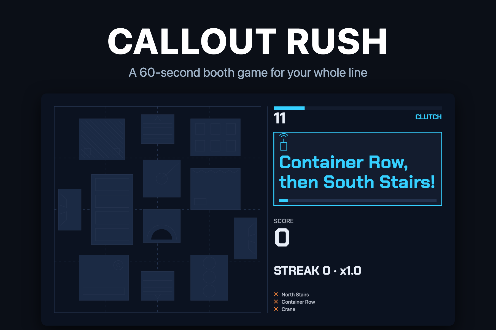
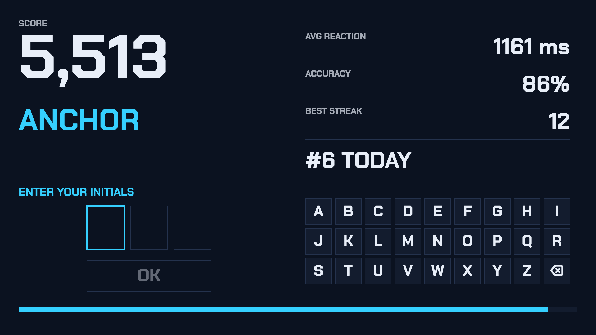

# AI Showcase: how Callout Rush was built by a loop

This is the story for the Best AI-Powered Workflow bonus. Callout Rush (a 60-second callout-reaction game for esports booths) was built by an AI coding agent working in a loop, with a human only setting direction. Everything below is checkable in this repository. Where a JetBrains tool did not do something, we say so.



## How the loop worked

The work was cut into small slices (`M0-07`, `M2-14`, ...) listed in `docs/ROADMAP.md`. Each lap, a fresh agent with no memory:

1. read `docs/STATUS.md` (its only memory) and the first open slice,
2. built that one slice,
3. ran the checks and quoted the real command output into STATUS,
4. made one commit with `Slice:` and `Loop:` trailers, and left a clean working tree.

A commit hook rejects badly formed commits, and a separate check compares the quoted output with the tool log. That made "it passed" mean "the command printed this". At the time of writing the repository has 88 commits (`git log --oneline | wc -l`).

## WebStorm inspection as a gate

`npm run check` ends with a headless WebStorm inspection (`app/scripts/inspect.mjs`, commit `9ce8781`). It needs no window or login and takes about 12 seconds. It is the last gate after `tsc`, ESLint, Vitest, the build and the browser tests.

**Case 1: a real finding, fixed (`64ed7fd`).** The inspection reported 49 warnings. One was real: the doc comment of `nextCall` in `app/src/core/calls.ts` lacked its `@param rng` line. Before and after:

```ts
 * 다음 콜을 만든다 (§4.3).
 * @param phase 단계 1~3 ...
```
```ts
 * 다음 콜을 만든다 (§4.3).
+ * @param rng 0 이상 1 미만 난수 함수 (시드를 줄 수 있다)
 * @param phase 단계 1~3 ...
```

**Case 2: 48 false positives, and what we did (`64ed7fd`).** The other 48 said "unused constant/function" for exports such as `GAME_MS` and `drawHud`. Headless mode cannot resolve imports between files, so it called every export unused, although grep showed other files use them. The agent turned that one inspection off in `.idea/inspectionProfiles/Project_Default.xml` with the reason as a comment, and left unused-code checking to `tsc`. Result: `INSPECT ok: 0 errors, 0 warnings`. We count this as a tool limit we worked around, not as 48 bugs found.

**Case 3: a blind spot found by testing the gate (`9ce8781`).** We added an unused local variable and an unused import on purpose to see whether the gate would fail. It did not report either. The agent recorded this as a failed acceptance test and the slice as partly done, instead of calling the gate complete. So the inspection covers only part of what the IDE editor shows.

Total real WebStorm findings: 1 (see `docs/jetbrains-usage.md`, where every number has a command).

## Problems the other gates caught

These were not found by a JetBrains tool, but they show the loop correcting itself:

- **Captures caught overlapping text (`a44153c`).** In the first screenshot the `+100` score covered the zone name tag, and the big `WARM-UP` word hid the map at round start. The agent read the screenshot, moved the score above the zone and removed the first-phase flash, and a test was updated to match.
- **A leaked server process (`18d1ba0`).** The first 1000-round soak run failed with "preview is off": a `vite preview` left by an earlier lap still held the port, because `npx` hides the child process from `kill()`. The tool now starts Vite directly with `node`.

## Junie and Air: what actually happened

- **Junie CLI:** installed (version 26.11.2) and given project rules in `.junie/AGENTS.md` (`029d107`). It never ran a task, because no `JUNIE_API_KEY` was available. It made 0 commits. We did not fake a Junie slice.
- **JetBrains Air:** installed, but it ships no command-line tool, so the loop could not drive it. 0 commits.

## What did not work well

- The unused-variable blind spot above.
- Several checks printed "pass" while a statistics test said the evidence was too weak. The agent then held back the word "pass" in STATUS instead of rounding up.
- Real-device feel (touch, a loud booth) cannot be tested offline. Only a human at a booth can.



## Verify it yourself

```
git cat-file -e 64ed7fd && git cat-file -e 9ce8781 && git cat-file -e a44153c && git cat-file -e 18d1ba0 && git cat-file -e 029d107 && echo ok
cd app && npm ci && npm run check
```
