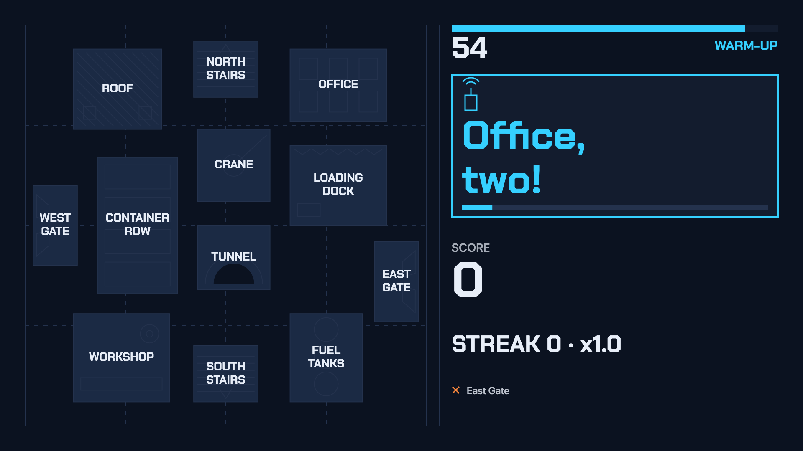
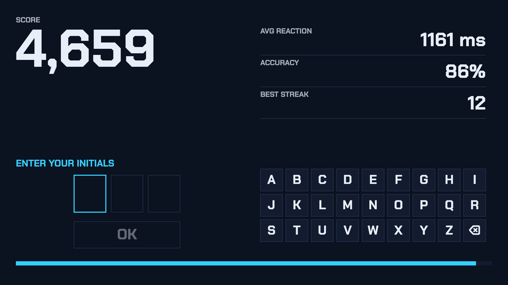

# Callout Rush

Read the call. Click the spot. A 60-second browser reaction game built for a trade-show booth.

A call such as `South Stairs, two!` appears. You click that spot on a tactical map before the time runs out. Hits build a streak, misses cost you, and a short `WARM-UP → LIVE → CLUTCH` ramp keeps one round under 95 seconds from first click to leaderboard, so the next fan in line never waits long. Mouse only, no sound files, no images, no network after load.

| Playing | Result |
|---|---|
|  |  |

## Play online

Live link: _(address goes here once the public page is up — see the roadmap item M2-16)_

## Download zip (no internet needed after unzip)

`제출본/callout-rush-web.zip` (about 70 KB). Unzip it, install Node.js 18 or newer, then double-click `start.command` (Mac) or `start.bat` (Windows), or run `node serve.mjs`. The game opens at `http://localhost:4173/`.

## Run from source

```
cd app
npm ci
npm run dev
```

Open the address Vite prints. Needs Node.js 18 or newer (developed on Node 23).

## Booth setup

1. **Open** the game in Chrome or Edge: the live link, or `http://localhost:4173/` from the zip.
2. **Operator menu:** press `Ctrl+Shift+O` (players do not know this key). It has `Open leaderboard window`, `Fullscreen`, `Mute`, `Export scores (CSV)`, `Clear today's scores` (asks twice) and `Booth health`. Close it with `Esc`.
3. **Second monitor:** click `Open leaderboard window` and drag the new window (`board.html`) to the second monitor. It updates the moment a score is saved.
4. **Full screen:** click `Fullscreen` in the operator menu on each window (1920×1080 is the design size; smaller and ultrawide windows scale to fit).
5. **Done.** Leave it running. With no one playing it shows an attract screen, and a round that is abandoned for 12 seconds resets itself for the next player.

Scores live in the browser's `localStorage` (up to 500 entries), so the booth works offline and a reload keeps them.

## How it works

```
app/
  src/core/   game rules, scoring, call generator, scores store, bot (no drawing)
  src/ui/     canvas drawing: map, HUD, effects, flow of screens, operator menu, board
  src/audio/  synthesized sound effects (Web Audio, no files)
  scripts/    command-line tools (screenshots, end-to-end run, soak test, zip)
docs/         design (DESIGN.md), status log, JetBrains usage log
제출본/       submission files: zip and screenshots
```

All tunable numbers live in `app/src/core/config.ts`; the reasoning for each is in `docs/DESIGN.md` section 6.

## Testing

```
cd app
npm run check     # type check, lint, unit tests, build, end-to-end, sound render, WebStorm headless inspection
npm run soak -- --games 1000 --timescale 10   # a bot plays 1000 rounds in a row and samples memory
```

Soak result (1000 rounds): _(numbers are written to `docs/soak-report.md` when the long run finishes; until then they are not claimed here)_

## Built with JetBrains tools

Which JetBrains tool did what, with numbers and commits: [docs/jetbrains-usage.md](docs/jetbrains-usage.md).

## License

MIT, see [LICENSE](LICENSE).
