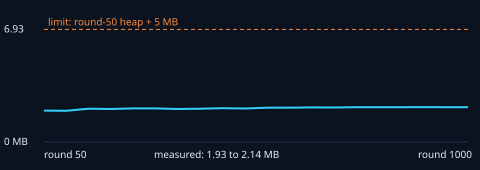

# Soak report — 1000 rounds in a row

A bot plays Callout Rush from the attract screen to the leaderboard and back, 1000 times in one browser page, without a reload. Every 50 rounds the script forces a garbage collection and writes one CSV row. The pass lines come from `docs/DESIGN.md` section 6.4.

## Setup

| Item | Value |
|---|---|
| Machine | Apple M2 Max, 96 GB, macOS 27.3 |
| Browser | Playwright Chromium 159.0.8154.6, headless, viewport 960x540 |
| Node | v23.11.0 |
| Command | `cd app && npm run build && npm run soak -- --games 1000 --timescale 10` |
| Clock speed-up | `timescale=10` (DESIGN asks for 30; this headless browser draws only 12 frames per second, and the bot moves once per frame, so 30 would not finish a round) |
| Run time | 6911 s (115 min), 1000 rounds |
| Raw data | `logs/soak.csv` (1000 rounds), `logs/soak-work.csv` (100-round re-run for the frame-work column) |

## Results against the four pass lines

| Line | Pass | Measured | Result |
|---|---|---|---|
| JS heap growth, round 50 to round 1000, after forced GC | <= 10% or <= 5 MB | 1.93 MB to 2.14 MB = +0.21 MB (+10.9%) | pass (by the 5 MB rule; the percent rule alone would fail, because the base is only 1.93 MB) |
| DOM node count between rounds | same (+-0) | 16 nodes at all 20 samples | pass |
| Frame p95 | <= 20 ms | see the note below: game work per frame p95 = 1.50 and 1.80 ms; raw frame interval p95 = 133 ms | pass on game work; interval not measurable on this machine |
| Errors (console errors and caught exceptions) | 0 | 0 | pass |

Also flat the whole run: event listeners 21, pending timers 0. Saved scores grow 13.1 KB per 50 rounds, 263 KB at round 1000, because the board keeps at most 500 scores and the soak never clears them (this run does not test the cap).

## Note on the frame line

The frame-interval p95 in the CSV (`frame_p95_ms`, 83 to 133 ms) is the time between two `requestAnimationFrame` calls. This headless Chromium produces about 12 frames per second here. An empty page with one 1920x1080 canvas and one `fillRect` per frame, measured on the same machine with the same browser, gives median 100.1 ms and p95 133.4 ms. So that column measures the headless browser, not the game, and cannot show 20 ms either way.

To measure the game's own share, `scripts/soak.mjs` now also records how long the game's `requestAnimationFrame` callbacks run in each frame (update and draw, summed per frame) and writes the p95 as `work_p95_ms`. In the 100-round re-run it is 1.50 ms (round 50) and 1.80 ms (round 100), far under 20 ms. Limits of this number: it does not include browser compositing and GPU time, and it was taken over 100 rounds, not 1000. A real 60 fps check on target hardware is not done here; the 60-minute real-speed run (M2-13) will add the interval on a visible browser if one is available.

## Verdict

Heap, DOM, error and game-work-per-frame lines pass. The raw frame-interval line is not claimed. No leak is visible: DOM, listeners and timers are flat across 1000 rounds, and the heap rises 0.21 MB in 950 rounds.

## Real-speed 60-minute run (M2-13)

A second run at real speed: `cd app && npm run soak -- --minutes 60 --timescale 1 --every 3 --out ../logs/soak60.csv` (same machine and browser as above, started 18:02 KST). Raw data: `logs/soak60.csv` (19 rows, every 3 rounds).

| Item | Measured |
|---|---|
| Length | 3732 s (62 min) and 57 rounds, about 65 s per round at `timescale=1`. The last row was written after the 3600 s deadline, so the loop ended by its own time check. The script's final `SOAK ok` line was not captured (the run was in the background without a log file), so its exit code is not recorded. |
| Errors (console errors and caught exceptions) | 0 in all 19 rows |
| Event listeners / pending timers / DOM nodes | 21 / 0 / 16 in all 19 rows (flat) |
| Game work per frame, p95 (`work_p95_ms`) | 1.0 to 1.3 ms in all 19 rows, far under the 20 ms line |
| Raw frame interval, p95 (`frame_p95_ms`) | 66.7 to 133.4 ms. Same limit as the note above: this headless Chromium draws about 12 frames per second, so the column measures the browser, not the game. No visible browser was used, so the 20 ms interval line is still not claimed. |
| JS heap, first 5 minutes vs last 5 minutes | first 5 min: one sample, 1.81 MB (at 193 s). Last 5 min (samples at or after 3300 s): 2.03, 2.07, 2.04 MB, mean 2.05 MB. Difference +0.24 MB (+13%). |
| Saved scores | 14.8 KB after 57 rounds (grows about 0.26 KB per round, same as the 1000-round run) |

Reading of the heap number: the DESIGN asks only that the difference is written down. It is small in absolute terms (0.24 MB) and the curve rises in steps and then stays flat (1.98 MB from round 27 to round 45, 2.03 to 2.07 MB after), which is how a growing score list and a few cached strings look, not a steady leak. DOM nodes, listeners and timers did not move at all. With only 19 samples and one in the first 5 minutes, this is not a proof; together with the 1000-round run (+0.21 MB over 950 rounds) it shows no leak.

Verdict for M2-13: 0 errors over 60 minutes, game work p95 1.3 ms at most, heap difference written down (+0.24 MB). The raw frame-interval line stays unclaimed.
